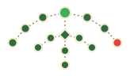

<p align="center">
  
  <br>
  <em>Autocomplete for zsh that reads the battlefield. A menu of your next move, as you type.</em>
</p>

# armin

[](https://github.com/rsdlt/armin/actions/workflows/ci.yml)

> *I've studied every command you've ever run. I know what you're about to type.*

armin opens a menu under your prompt as you type, listing the commands you're most likely
after. It learns from your history: what you run often, what you ran lately, and what you
run in this directory. `Tab` to pick, `Enter` to run it.

```
% git s
 git status
 git stash pop
 git switch staging
```

## Why armin

zsh-autosuggestions shows one guess, the most recent command that starts with what you typed,
and you accept it with `→`. If that guess is wrong, you keep typing and hope.

armin shows the eight best guesses at once, like the completion menu in your editor. It ranks
them by what you actually do: the command you run ten times a day beats the one you ran once
this morning, and inside a project, that project's commands lead. A typo that failed with
"command not found" never comes back.

Named after the Survey Corps' strategist, armin is small and thinks ahead. He's not a
completion framework: he does one thing, and he does it before you finish typing.

## Enlist

You need zsh.

```sh
brew install rsdlt/tap/armin
```

With Rust, run `cargo install armin`, or `cargo binstall armin` for a prebuilt binary. The
[latest release](https://github.com/rsdlt/armin/releases/latest) has binaries for macOS and
Linux.

Then add armin to `~/.zshrc`, and bring in the history you already have:

```sh
eval "$(armin init zsh)"
```

```sh
armin import    # reads ~/.zsh_history; run it once
```

For zsh's own completions in the menu (flags, subcommands, files, git branches), load zsh's
completion system too, if your `~/.zshrc` doesn't already:

```sh
autoload -Uz compinit && compinit
```

If zsh then warns about insecure directories, Homebrew's are group-writable; this fixes them:

```sh
autoload -Uz compaudit && compaudit | xargs chmod g-w
```

Until they're fixed, `compinit -i` skips them, and with them the completions Homebrew
installed.

armin draws where zsh-autosuggestions does, so remove that plugin. zsh-syntax-highlighting
works alongside armin. fzf-tab does what armin does on `Tab`, so use one of the two.

## Orders

Start typing. The menu opens after the first character and follows every keystroke.

With the menu closed, press `Tab`. On an empty line, the menu opens with what you usually run
next. On a word, it opens with zsh's own completions for it: flags, subcommands, files, git
branches, whatever the command's completion knows, with descriptions. Either way the first
row is already on the line. A completion replaces only the word you're on, and the ones
you've used with this command before come first.

When the history menu only has loose matches, nothing that starts with what you typed, `Tab`
skips it and opens zsh's completions; `C-n` still picks those rows. To reach the completions
past a history menu that does, `Esc` and then `Tab`.

| Key | Action |
|---|---|
| `Tab` `S-Tab` | move through the menu, putting the selected command on the line |
| `C-n` `C-p` | the same |
| `Enter` | run the line |
| `Esc` | put back what you typed and close the menu |

Beside the menu, a panel tells you about the selected row: for a command from your history,
how often and when it last ran, where, how it ended and how long it takes; for a row the menu
cuts short, the whole command or description. It shows where the pane has room for it, and
`ARMIN_PANEL=0` turns it off.

You see the whole command on the line before `Enter` runs it. Keep typing instead, and you
edit the command you picked.

With the menu closed, every other key does what it did before: in vi mode `Esc` still enters
command mode. When armin has nothing to offer, or you're inside an open quote, `Tab` does
what it did before too.

## Strategy

Each past run of a command adds to its score, and older runs add less: a run a week ago counts
half, a month ago a fifth. Runs in the directory you're in count again on top. A command that
failed counts half, since `grep` finding nothing fails too. A command that only ever failed
with "command not found" is dropped.

Commands that start with what you typed come first. Below them, fuzzy matches fill in, so
`gco` finds `git checkout`, with the matched letters in bold.

zsh's completions keep zsh's order, except that the ones past runs of the same command used
come first, most used first: `git switch <Tab>` lists the branches you switch to. A folder
counts the files you used in it.

On an empty line there's nothing to match, so armin predicts. Each past time a command ran
right after the one you just ran, in the same shell, counts on top of its score: after
`git add .` comes `git commit`. A typo that failed with "command not found" doesn't count as
what came before.

## Intel

armin records every command you run, with the directory it ran in, its exit code and how long
it took. It writes in the background, so your prompt never waits. Everything stays on your
machine, in a plain text file you can read, grep or delete: `~/.local/share/armin/history`
(`$XDG_DATA_HOME/armin` or `$ARMIN_DATA_DIR`, if set).

Like zsh, armin skips commands that start with a space when `HIST_IGNORE_SPACE` is set.

## Configure

Set these before the `eval` line:

| Variable | Default | |
|---|---|---|
| `ARMIN_MAX_ROWS` | `8` | how many suggestions the menu shows |
| `ARMIN_HL_MATCH` | `bold` | the letters that match what you typed |
| `ARMIN_HL_SELECTED` | `standout` | the selected row |
| `ARMIN_HL_DESCRIPTION` | `fg=8` | a completion's description |
| `ARMIN_HL_PANEL` | `fg=8` | the line between the menu and the panel |
| `ARMIN_PANEL` | `1` | the panel beside the menu; `0` turns it off |
| `ARMIN_PROMPT_WIDTH` | measured | your prompt's last line, so the menu lines up under the word |

Colors use zsh's highlight syntax, like `fg=blue,bold`, and default to your terminal's palette.

armin measures a plain prompt itself. A prompt a program draws, like starship's, it doesn't run
again just to measure: it takes 2 columns, as for `❯ `, unless `ARMIN_PROMPT_WIDTH` says
otherwise.

## Field report

- **Swift.** Ranking takes under a tenth of a millisecond per keystroke, 99 times in 100, on a
  history of a thousand commands (`armin bench` measures yours).
- **Small.** About 2,700 lines of Rust and zsh, tests included, and two dependencies.
- **Native.** armin draws through zsh's own line editor, not a window over your terminal, so
  it works the same in tmux, zellij, herdr, screen and over ssh.

armin is young. Coming up: a panel with the selected command's details, and colors you can
set in a config file.

## License

[MIT](LICENSE). Free to use, like a map of the walls, shared with anyone who asks.
